

  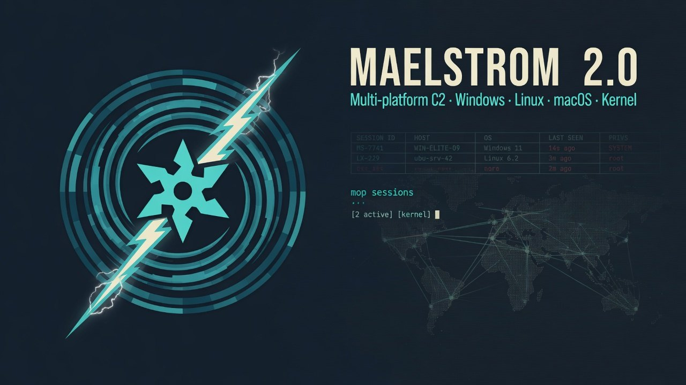
   
  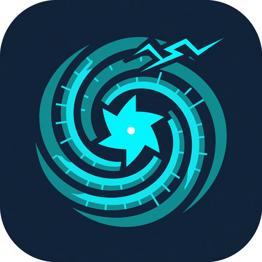
  <h1>Maelstrom 2.0</h1>
  
<em>Kernel C2. Post-quantum TLS. Full EDR evasion guarantee. An AI agent runs the stack through mop.</em>

  

    
    
    
    
  

  

    Public product page · source is private · annual subscription 
    <a href="#contact">Contact / license</a>
    ·
    <a href="LICENSE">Maelstrom Software License 2.0</a>
  

  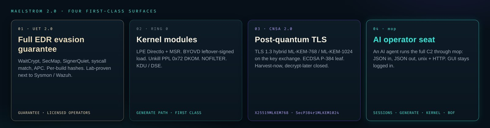

This repository is the **public front** of Maelstrom 2.0 — demo images and the feature list. The teamserver, Qt GUI, mop API, implants, builders, and kernel modules ship to licensed operators. Possession of this page is not a license.

Authorized red team and laboratory use. Annual license — [contact](#contact).

---

## Full EDR evasion guarantee

  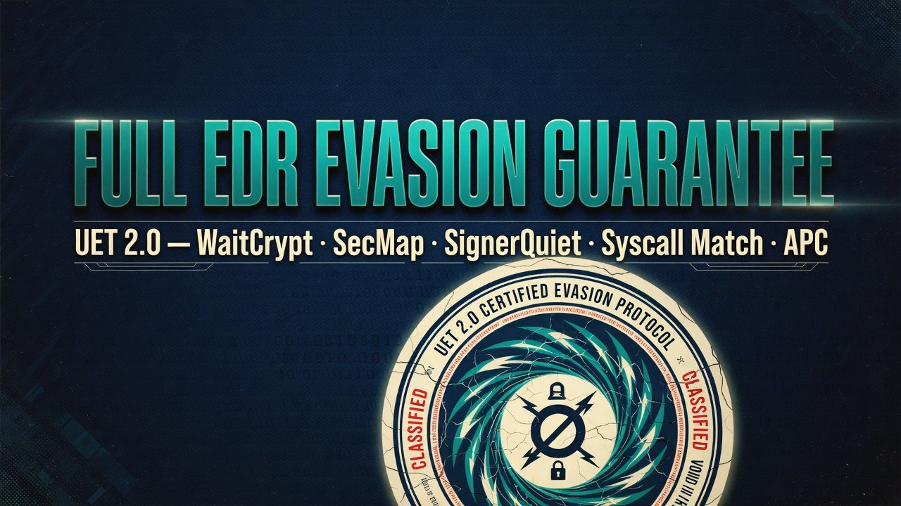

**UET 2.0** is the full EDR evasion guarantee for licensed operators:

WaitCrypt · SecMap (`MEM_MAPPED` PIC) · SignerQuiet (`SEC_IMAGE` on a Microsoft System32 image) · syscall match · APC · per-build API hashes.

Lab-proven next to Sysmon / Wazuh. Each implant build has its own hash class.

---

## vs Cobalt Strike

  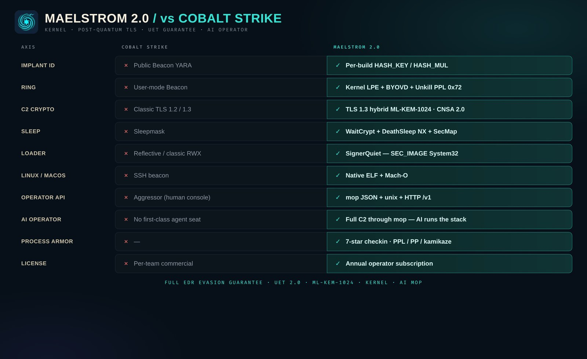

| | Cobalt Strike | **Maelstrom 2.0** |
|---|---|---|
| Implant ID | Public Beacon YARA | **Per-build HASH_KEY / HASH_MUL** |
| Ring | User-mode Beacon | **Kernel LPE + BYOVD + Unkill PPL** |
| C2 crypto | Classic TLS | **TLS 1.3 hybrid ML-KEM-768 / ML-KEM-1024 (CNSA 2.0)** |
| Sleep | Sleepmask | **WaitCrypt + DeathSleep NX + SecMap** |
| Loader | Reflective / classic RWX | **SignerQuiet — SEC_IMAGE System32** |
| Linux / macOS | SSH beacon | **Native ELF + Mach-O** |
| Operator API | Aggressor | **mop JSON + unix + HTTP /v1** |
| AI operator | Human console | **Full C2 through mop — AI runs the stack** |
| Process armor | — | **7-star checkin (PPL / PP / kamikaze)** |
| License | Per-team commercial | **Annual operator subscription** |

---

## AI operator — full C2 through mop

  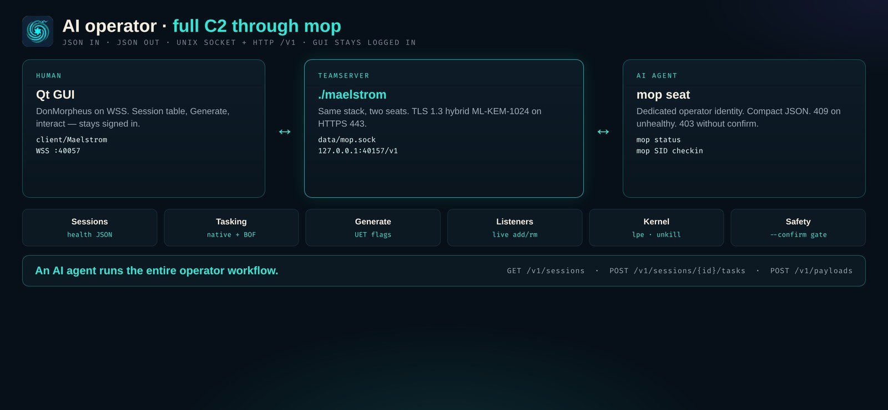

mop is a first-class operator seat, built for an AI agent. JSON in, JSON out. The Qt GUI stays logged in.

The agent drives sessions, Generate, listeners, BOF modules, and the kernel kit (`lpe` / `unkill` / `byovd`). Unhealthy sessions return 409. Destructive tasks need an explicit confirm.

  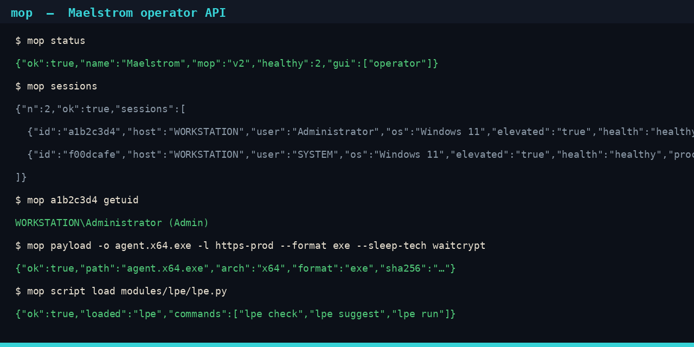

---

## Post-quantum C2

  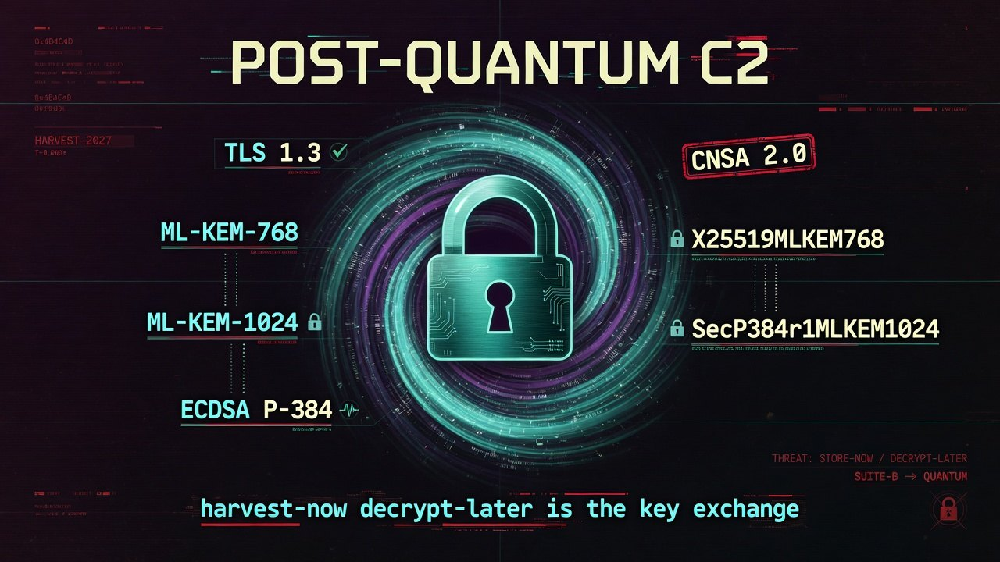

HTTPS 443 is TLS 1.3 with hybrid ML-KEM on the **key exchange** (harvest-now, decrypt-later).

| Group | Suite |
|-------|--------|
| `X25519MLKEM768` | IANA 0x11EC |
| `SecP384r1MLKEM1024` | CNSA 2.0 / IANA 0x11ED — ML-KEM-1024 + P-384 |
| Leaf | ECDSA **P-384** |
| MinVersion | TLS 1.3 |

Classical X25519 / P-384 stay as fallback for older Schannel.

---

## Kernel stack

  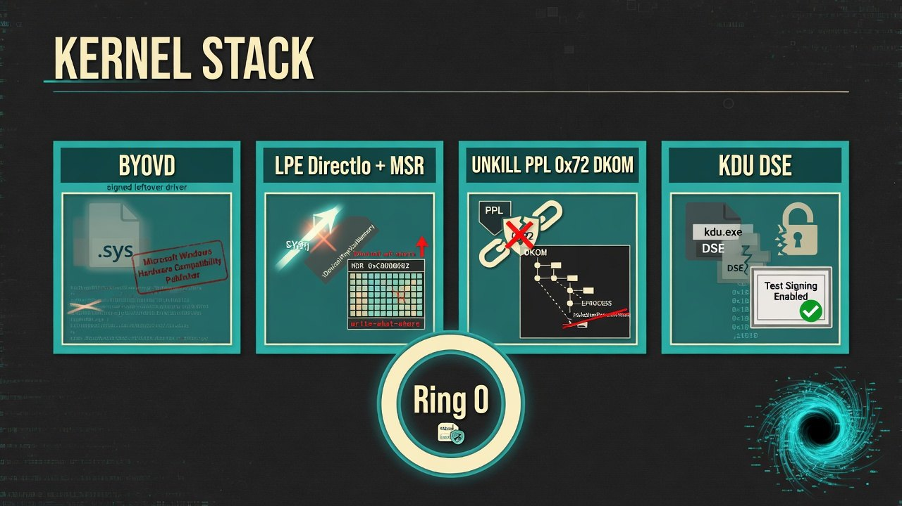

Ring 0 is a first-class Generate path.

| Module | Job |
|--------|-----|
| **Kernel LPE** | DirectIo + MSR. Token steal. Windows 10 / 11 24H2+ |
| **BYOVD** | Leftover-signed driver load, Generate-linked |
| **Unkill** | Fileless DKOM — PPL WinSystem, process armor |
| **NOFILTER** | Kernel print-spooler LPE |
| **KDU / DSE** | DSE play via the kernel operator kit |

---

## Architecture

  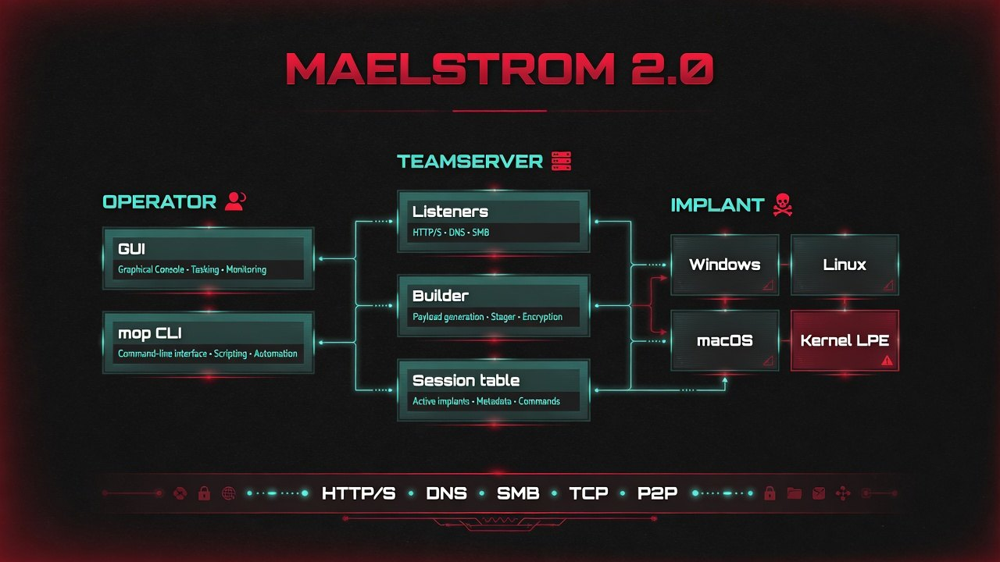

| Seat | Role |
|------|------|
| Qt GUI | Human operator, WSS |
| **mop** | AI operator — JSON, unix socket, loopback HTTP |
| Teamserver | Listeners + implants |
| Implant | Windows / Linux / macOS / Kernel PE |

Listeners: HTTP(S), DNS, SMB, TCP, P2P. Generate in-process: exe, dll, svc, shellcode, .NET, droppers, STG1.

  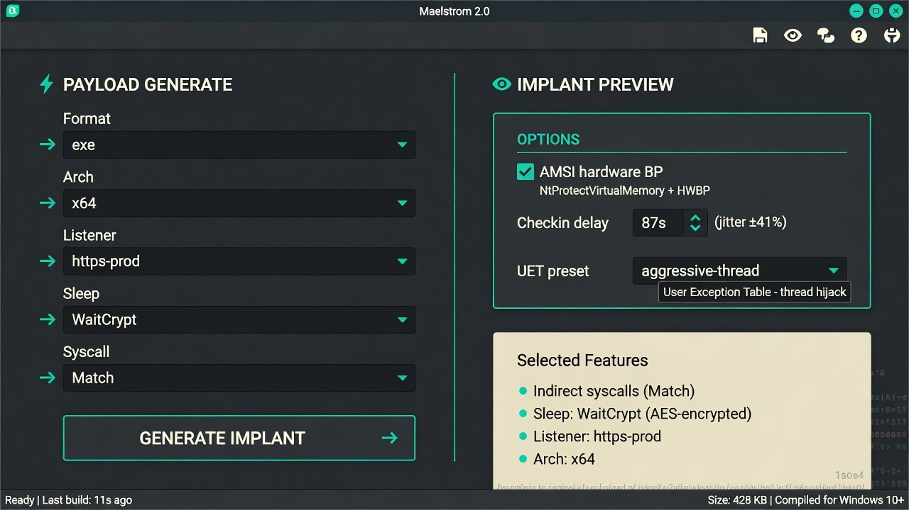

---

## License

Maelstrom 2.0 is proprietary commercial software. One annual subscription covers a named operator (or named team, if the order says so) for twelve months.

GUI payment gate after Unkill GA. Until then, DonMorpheus activates subscribers by hand.

Full terms: [LICENSE](LICENSE).

---

## Contact

| | |
|---|---|
| **GitHub Issues** | [Open a license / demo request](https://github.com/DonMorpheus/maelstrom-c2/issues/new?template=demo.md) |
| **Email** | [morpheusdon5@gmail.com](mailto:morpheusdon5@gmail.com) |
| **GitHub** | [DonMorpheus](https://github.com/DonMorpheus) |

Issues stay on this public repo. Email is for a briefing, a demo, or an annual seat. Authorized red-team and owned-lab scope only.

---

  
<strong>FULL EDR EVASION GUARANTEE</strong> · UET 2.0 · ML-KEM-1024 · KERNEL · AI MOP

  
<strong>Maelstrom Software License 2.0</strong> · © 2026 DonMorpheus · annual subscription

  
Authorized red-team and laboratory use. This page is not the source tree.

